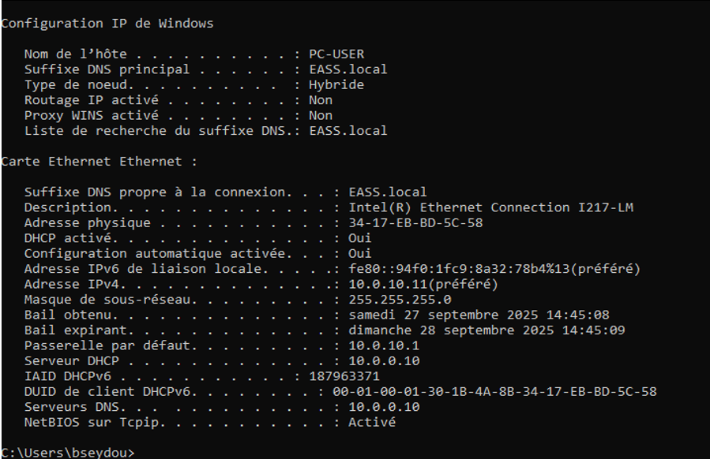
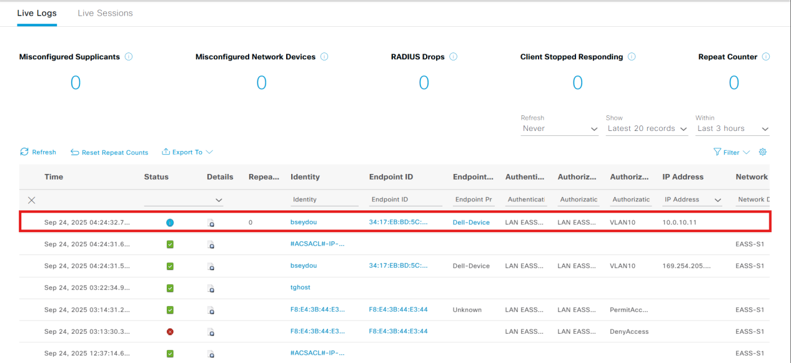
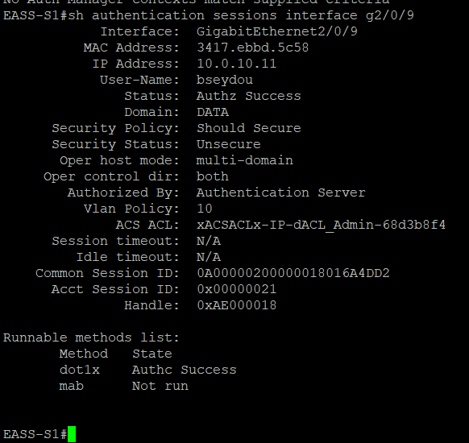

# Network Access Control — Validation Tests

## 1. Test Objectives

The validation phase was conducted to verify the effectiveness of the Cisco ISE NAC implementation.

The main objectives were to confirm:

- Successful IEEE 802.1X authentication.
- Dynamic VLAN assignment based on Active Directory groups.
- Successful RADIUS authentication and authorization.
- Enforcement of downloadable Access Control Lists (dACLs).
- Network access restrictions based on user roles.

## 2. Authentication Results

| User Profile | Assigned VLAN | Authentication Result |
|---|---|---|
| Administrator | VLAN 10 | Successful |
| Employee | VLAN 20 | Successful |
| Network Sponsor | VLAN 20 | Successful |
| System Sponsor | VLAN 20 | Successful |

Authentication results were verified using Cisco ISE logs, switch authentication sessions, and Windows client network information.

### Administrator Authentication Evidence

The administrator successfully authenticated through IEEE 802.1X using Cisco ISE and Active Directory.

Following authentication, the administrator was dynamically assigned to VLAN 10.

**1. Administrator Client — Network Configuration**

**2. Cisco ISE — Authentication Logs**

The Cisco ISE logs confirm successful administrator authentication.

**3. Cisco Switch — Authentication Session**

The switch authentication session confirms the successful authorization of the administrator.

## 3. Network Access Validation

The following access restrictions were verified after successful authentication.

| User Profile | Internet | Active Directory | Cisco ISE | Network Equipment |
|---|---|---|---|---|
| Administrator | Allowed | Allowed | Allowed | Allowed |
| Employee | Allowed | Denied | Denied | Denied |
| Network Sponsor | Allowed | Denied | Denied | Allowed |
| System Sponsor | Allowed | Allowed | Denied | Denied |

## 4. Verification Methods

The tests included:

- Checking authentication status on Windows client devices.
- Reviewing successful authentication logs in Cisco ISE.
- Verifying authenticated sessions on the Cisco switch.
- Checking dynamic VLAN assignment.
- Performing connectivity tests to validate access restrictions.

## 5. Observed Results

The tests confirmed that Cisco ISE successfully authenticated users and applied network authorization policies according to their assigned roles.

Administrators received broader access privileges, while employees and sponsors were restricted to the resources required by their respective roles.

## 6. Evidence

Screenshots of the authentication sessions, Cisco ISE logs, switch logs, and connectivity tests are documented in Chapter 3 of the original project report.

A video demonstration will be linked here when available.

## 7. Limitations

The guest access workflow and endpoint posture assessment were not fully validated due to infrastructure and licensing constraints.
